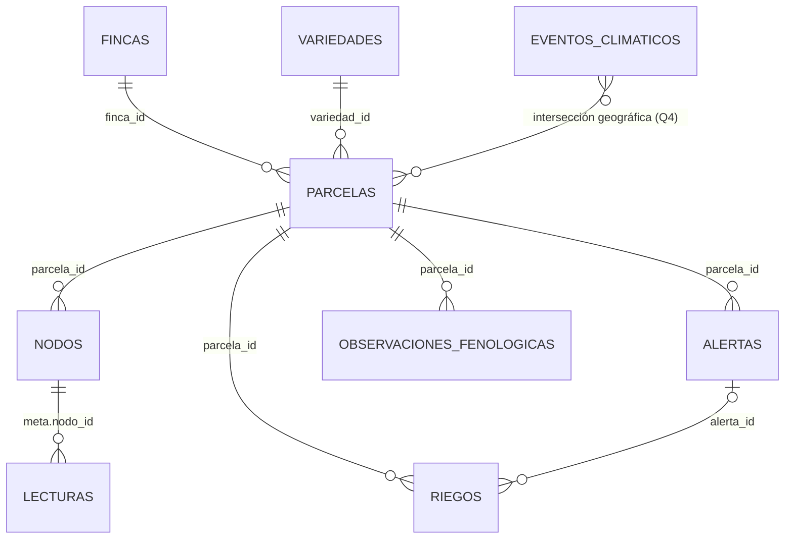

# Modelo de datos

**Estado:** v1.0 (14/10/2026). Decisiones en [ADR-001](decisions/ADR-001-series-temporales.md), [ADR-003](decisions/ADR-003-decisiones-modelado-inicial.md), [ADR-004](decisions/ADR-004-temporada-malbec.md), [ADR-005](decisions/ADR-005-parametros-simulacion.md), [ADR-006](decisions/ADR-006-modelo-de-datos.md) y [ADR-007](decisions/ADR-007-validacion-lecturas.md). Parámetros y fuentes en [`investigacion/verificacion-fuentes.md`](investigacion/verificacion-fuentes.md).

## 1. Consultas que guían el modelo

Ver Q1 a Q10 en [`requisitos.md`](requisitos.md). El modelo es adecuado si las responde de forma simple y eficiente.

## 2. Convenciones

| Tema | Regla |
|---|---|
| Nombres | Español, `snake_case`, sin tildes ni eñes. Los valores de texto sí pueden llevar tildes (por ejemplo, `"San Martín"`) |
| Unidades | En el nombre del campo: `_c` (°C), `_pct` (%), `_mm`, `_m`, `_ha`, `_min` |
| Fechas | Tipo `date`, en UTC. El dashboard las muestra en hora de Argentina (UTC−3) |
| Geometrías | GeoJSON en WGS84, orden `[longitud, latitud]` |
| Identificadores | Códigos legibles para fincas, parcelas y nodos (`F-SR`, `P-SR-1`, `N-SR-1-A`); `ObjectId` automático para los eventos (alertas, riegos, observaciones, eventos climáticos) |
| Validación | `$jsonSchema` con `validationAction: "error"` y esquema cerrado (`additionalProperties: false`) en las colecciones comunes; `lecturas` se valida en el simulador y con una consulta de auditoría (ADR-007) |
| Origen del dato | `fuente`: `"simulado"`, `"simulacion_en_vivo"` o `"seed"`. Lo generado en vivo lleva además `escenario_id` |

## 3. Colecciones

### 3.1 `fincas` (colección común)

| Campo | Tipo | Obligatorio | Descripción |
|---|---|---|---|
| `_id` | string | sí | Código legible: `F-SR`, `F-TU`, `F-SM` |
| `nombre` | string | sí | Nombre ficticio |
| `departamento` | string | sí | `"San Rafael"`, `"Tupungato"` o `"San Martín"` |
| `oasis` | string | sí | `"Sur"`, `"Valle de Uco"` o `"Este"` |
| `altitud_m` | number | sí | Altitud aproximada |
| `geometria` | Polygon | sí | Contorno de la finca |
| `sistema_riego` | string | sí | `"surco"` o `"goteo"` (ADR-005) |
| `tipo_suelo` | string | sí | `"franco"`, `"franco_arenoso"` o `"pedregoso"` (ADR-005) |
| `ficticia` | bool | sí | Siempre `true` |

### 3.2 `parcelas` (colección común)

| Campo | Tipo | Obligatorio | Descripción |
|---|---|---|---|
| `_id` | string | sí | `P-SR-1`, `P-SR-2`, … |
| `finca_id` | string | sí | Referencia a `fincas._id` |
| `nombre` | string | sí | Nombre del cuartel |
| `variedad_id` | string | sí | Referencia a `variedades._id` (`"malbec"`) |
| `superficie_ha` | number | sí | 2 ha (supuesto, `investigacion/vid-malbec.md`) |
| `geometria` | Polygon | sí | Contorno de la parcela (Q4) |
| `conduccion` | string | sí | `"espaldero"` o `"parral"` |
| `densidad_plantas_ha` | int | sí | 4.000 (supuesto) |

La etapa fenológica **no** se guarda en la parcela: se calcula (sección 5).

### 3.3 `nodos` (colección común)

| Campo | Tipo | Obligatorio | Descripción |
|---|---|---|---|
| `_id` | string | sí | `N-SR-1-A`, `N-SR-1-B`, … (2 por parcela) |
| `parcela_id` | string | sí | Referencia a `parcelas._id` |
| `finca_id` | string | sí | Referencia a `fincas._id` (copia, para filtrar sin `$lookup`) |
| `ubicacion` | Point | sí | Posición del nodo (Q3) |
| `estado` | string | sí | Estado administrativo: `"activo"`, `"mantenimiento"` o `"baja"`. Si dejó de reportar se calcula con Q5 |
| `instalado` | date | sí | Fecha de instalación |
| `variables` | array de string | sí | Variables que mide: `temperatura_c`, `humedad_suelo_pct`, `humedad_aire_pct` |

### 3.4 `lecturas` (serie temporal)

`timeField: "ts"`, `metaField: "meta"`, `granularity: "minutes"`.

| Campo | Tipo | Obligatorio | Descripción |
|---|---|---|---|
| `ts` | date | sí | Momento de la lectura (cada 5 minutos) |
| `meta.nodo_id` | string | sí | Nodo que midió |
| `meta.parcela_id` | string | sí | Parcela del nodo |
| `meta.finca_id` | string | sí | Finca del nodo |
| `meta.fuente` | string | sí | `"simulado"` o `"simulacion_en_vivo"` |
| `meta.escenario_id` | string | no | Solo en simulaciones en vivo; permite borrarlas (RF-15) |
| `temperatura_c` | number | sí | Temperatura del aire en el sensor (abrigo) |
| `humedad_suelo_pct` | number | sí | Humedad volumétrica del suelo |
| `humedad_aire_pct` | number | sí | Humedad relativa del aire |

No guarda ubicación: vive en `nodos` (spike del 14/10/2026). Las lecturas no se corrigen; se borran y se vuelven a insertar.

### 3.5 `alertas` (colección común)

| Campo | Tipo | Obligatorio | Descripción |
|---|---|---|---|
| `_id` | ObjectId | sí | Automático |
| `tipo` | string | sí | `"helada"` o `"riego"` |
| `parcela_id` | string | sí | Referencia a `parcelas._id` (ADR-003: solo referencias) |
| `estado` | string | sí | `"abierta"` o `"cerrada"` |
| `inicio` | date | sí | Momento en que se cruzó el umbral |
| `fin` | date o null | sí | `null` mientras está abierta |
| `etapa_bbch` | int | sí | Etapa de la parcela al abrir la alerta |
| `umbral` | number | sí | Umbral aplicado: °C del brote (helada) o % de humedad de suelo (riego) |
| `valor_extremo` | number | sí | Mínima registrada: temperatura del brote (helada) o humedad de suelo (riego). Se actualiza mientras está abierta |
| `riesgo` | objeto o null | sí | Solo helada, al cerrar: `{ nivel, margen_c, agravantes }`. `null` en riego y mientras está abierta |
| `fuente` | string | sí | `"simulado"` o `"simulacion_en_vivo"` |
| `escenario_id` | string | no | Solo en simulaciones en vivo |

`riesgo.nivel` es `"bajo"`, `"medio"` o `"alto"`; `riesgo.agravantes` es una lista con `"duracion"`, `"aire_seco"` y/o `"suelo_seco"` (ADR-005).

### 3.6 `riegos` (colección común)

| Campo | Tipo | Obligatorio | Descripción |
|---|---|---|---|
| `_id` | ObjectId | sí | Automático |
| `parcela_id` | string | sí | Referencia a `parcelas._id` |
| `inicio` | date | sí | Inicio del riego |
| `fin` | date | sí | Fin del riego |
| `sistema` | string | sí | `"surco"` o `"goteo"` |
| `origen` | string | sí | `"turno"` o `"alerta"` (riego mixto, ADR-004) |
| `alerta_id` | ObjectId | no | Alerta de riego que lo originó, si `origen` es `"alerta"` |
| `lamina_mm` | number | sí | Lámina bruta aplicada (lo que informan las fuentes) |
| `litros` | number | sí | `lamina_mm × superficie_ha × 10.000`, calculado al insertar (Q7) |
| `fuente` | string | sí | `"simulado"` o `"simulacion_en_vivo"` |
| `escenario_id` | string | no | Solo en simulaciones en vivo |

### 3.7 `eventos_climaticos` (colección común)

Colección común porque guarda polígonos, que las series temporales no indexan (spike del 14/10/2026).

| Campo | Tipo | Obligatorio | Descripción |
|---|---|---|---|
| `_id` | ObjectId | sí | Automático |
| `tipo` | string | sí | `"helada"` (el granizo queda fuera de alcance: ningún sensor del MVP lo mide) |
| `inicio` | date | sí | Comienzo del evento |
| `fin` | date | sí | Fin del evento |
| `area` | Polygon | sí | Zona afectada (Q4) |
| `temperatura_minima_c` | number | no | Mínima del evento, si es helada |
| `descripcion` | string | no | Texto libre |
| `fuente` | string | sí | `"simulado"` o `"seed"` |

### 3.8 `observaciones_fenologicas` (colección común)

| Campo | Tipo | Obligatorio | Descripción |
|---|---|---|---|
| `_id` | ObjectId | sí | Automático |
| `parcela_id` | string | sí | Referencia a `parcelas._id` |
| `fecha` | date | sí | Día de la observación |
| `etapa_bbch` | int | sí | Etapa observada (0 a 99) |
| `observador` | string | sí | Rol, no nombre: `"tecnico"` o `"encargado"` (el repo es público) |
| `notas` | string | no | Texto libre |
| `fuente` | string | sí | `"seed"` (precargadas, ADR-004) |

### 3.9 `variedades` (configuración)

| Campo | Tipo | Obligatorio | Descripción |
|---|---|---|---|
| `_id` | string | sí | `"malbec"` (y `"variedad_x"` si se agrega) |
| `nombre` | string | sí | Nombre visible |
| `ficticia` | bool | sí | `false` para Malbec; `true` para la variedad simulada X |
| `grados_dia` | objeto | sí | `{ base_c: 10, tope_c: 32, inicio: { mes: 9, dia: 1 }, hasta_brotacion: 70 }` |
| `etapas` | array de objetos | sí | Una entrada por etapa (ver abajo) |

Cada elemento de `etapas`:

| Campo | Tipo | Descripción |
|---|---|---|
| `bbch_desde`, `bbch_hasta` | int | Rango de códigos BBCH de la etapa |
| `nombre` | string | Nombre simple (por ejemplo, `"Brotación"`) |
| `baggiolini` | string | Letra equivalente, solo para mostrar |
| `umbral_helada_c` | number o null | Umbral sobre la temperatura del brote; `null` si la etapa no se evalúa |
| `gd_desde_brotacion` | number o null | Grados-día desde la brotación para llegar a la etapa |

### 3.10 `configuracion` (configuración)

Un único documento con `_id: "general"`.

| Campo | Tipo | Descripción |
|---|---|---|
| `delta_brote_c` | number | Δ entre sensor y brote: 2 °C (ADR-005, supuesto) |
| `nodo_inactivo_min` | int | Minutos sin lecturas para considerar un nodo inactivo: 30 |
| `sospechoso_minimo_c` | objeto | Límite de "sospechoso" de la temperatura del sensor (`temperatura_c`) por departamento (°C), con `maximum: 0`: `san_rafael` −4,5 y `san_martin` −2,8 (récord de septiembre del SMN, [`verificacion-fuentes.md`](investigacion/verificacion-fuentes.md)); `tupungato` −5,6 (sin estación del SMN: supuesto adoptado, calculado con La Consulta, [ADR-012](decisions/ADR-012-cierre-de-supuestos.md)). Una lectura estrictamente más fría es sospechosa: no se rechaza ni se excluye, solo se cuenta en la auditoría ([ADR-009](decisions/ADR-009-temperatura-sospechosa-y-noche-extrema.md)) |
| `noche_extrema` | objeto | La única noche que puede superar ese límite (RF-13): `{ finca_id, inicio, fin, minimo_c }`, ventana en UTC. Hoy: San Rafael, 5/10/2026 de 03:00 a 08:00 hora de Argentina, `minimo_c` −6,3 °C (supuesto adoptado: cifra de prensa −8,3 °C menos Δ) ([ADR-009](decisions/ADR-009-temperatura-sospechosa-y-noche-extrema.md)) |
| `riesgo` | objeto | Cortes del índice: `{ margen_bajo_c: 2, margen_alto_c: 0, horas_duracion: 2, margen_duracion_c: 1, aire_seco_pct: 60 }` |
| `umbrales_riego` | objeto | Umbral de humedad de suelo (%) por tipo de suelo y período (`sep_oct`, `nov`, `dic_ene`, `feb_mar`) |

## 4. Relaciones y decisiones de modelado

Regla de partida: **embeber lo que se lee junto y no crece; referenciar lo que crece o se consulta por separado.**

| Relación | Decisión | Motivo |
|---|---|---|
| Finca → parcelas | Referencia (`parcelas.finca_id`) | Q4 busca parcelas por geometría y Q8 encadena alertas → parcelas → fincas (ADR-003) |
| Parcela → nodos | Referencia (`nodos.parcela_id`) | Q3 busca nodos con `$geoNear` sobre `nodos` (spike) |
| Nodo → lecturas | Referencia en `meta` | Las lecturas crecen sin límite (unas 732.700) |
| Lectura → parcela y finca | Copia en `meta` (`parcela_id`, `finca_id`) | Filtrar sin `$lookup` sobre cientos de miles de documentos (ADR-003) |
| Parcela → alertas, riegos, observaciones | Referencia (`parcela_id`) | Crecen con el tiempo |
| Variedad → etapas | **Embebido** (array `etapas`) | Siempre se leen juntas y son pocas (ADR-006) |
| Parcela → etapa actual | **No se guarda**, se calcula | Depende de la fecha elegida en el dashboard (ADR-006) |
| Alerta de helada → riesgo | **Se guarda** al cerrar | El historial no cambia si cambian los cortes (ADR-006) |
| Parámetros | Colección `configuracion` | Un solo lugar, sin tocar código (ADR-006) |

## 5. Reglas calculadas (no se guardan)

| Dato | Cómo se obtiene |
|---|---|
| Etapa fenológica de una parcela en una fecha | Última observación hasta esa fecha; si no hay, Q9 (grados-día acumulados desde `grados_dia.inicio`) |
| Temperatura del brote | `temperatura_c − configuracion.delta_brote_c` |
| Nodo inactivo | Q5: sin lecturas en los últimos `nodo_inactivo_min` minutos respecto de la fecha de referencia |
| Departamento de una alerta | `$lookup` alertas → parcelas → fincas (Q8) |

## 6. Diagrama



`configuracion` no se relaciona por referencias: la leen el simulador y las consultas.

## 7. Validaciones

Implementadas y probadas: ver [`esquemas-validacion.md`](esquemas-validacion.md).

Un archivo por colección en `db/schemas/` con su `$jsonSchema` (`validationAction: "error"`, `additionalProperties: false`, con `_id` declarado en `properties`).

**Excepción: `lecturas`.** En MongoDB 9.0.2 las series temporales no admiten validador ([spike de esquemas](spikes/spike-esquemas-validacion.md)). Su esquema se escribe igual, pero se usa de dos formas ([ADR-007](decisions/ADR-007-validacion-lecturas.md)):

1. El simulador valida cada lote antes de insertarlo: MongoDB valida con el mismo esquema, sin guardar (`db/schemas/validar.py`, [ADR-008](decisions/ADR-008-esquemas-en-python.md)).
2. Una consulta de auditoría, `find({ $nor: [{ $jsonSchema: esquema }] })`, cuenta las lecturas que no cumplen el esquema después de cada carga (resultado esperado: 0).

## 8. Índices (creados y medidos)

Todos se crean con `python -m db.indexes.crear_indices` ([ADR-014](decisions/ADR-014-consultas-en-python.md) y [ADR-015](decisions/ADR-015-indices-de-rendimiento.md)). Cada uno tiene una medición antes y después en [`performance.md`](performance.md); la propuesta inicial se corrigió con esas mediciones (`alertas` ahora es `{ tipo, inicio }` y se agregó el de `lecturas` para Q5).

| Colección | Índice | Consulta que lo justifica | Documentos examinados |
|---|---|---|---|
| `lecturas` | `{ meta: 1, ts: 1 }` (lo crea MongoDB solo) | Ninguna lo usa; se deja (experimento en `performance.md`) | - |
| `lecturas` | `{ "meta.nodo_id": 1, ts: -1 }` | Q5 | 5.053 → 433 |
| `nodos` | `{ ubicacion: "2dsphere" }` | Q3 (sin él falla) | falla → 12 |
| `parcelas` | `{ geometria: "2dsphere" }` | Q4 | 9 → 5 |
| `eventos_climaticos` | `{ area: "2dsphere" }` | Q4 | - |
| `alertas` | `{ tipo: 1, inicio: 1 }` | Q8 | 57 → 32 |
| `riegos` | `{ parcela_id: 1, inicio: 1 }` | Q7 | 563 → 33 |
| `observaciones_fenologicas` | `{ parcela_id: 1, fecha: -1 }` | Q9 (y Q2 y Q10, que la llaman) | 1.092 → 846 |

## 9. Ejemplos de documentos

Coordenadas y nombres ficticios.

```js
// fincas
{ _id: "F-SR", nombre: "Finca Los Álamos", departamento: "San Rafael", oasis: "Sur",
  altitud_m: 751, geometria: { type: "Polygon", coordinates: [[ /* ... */ ]] },
  sistema_riego: "surco", tipo_suelo: "franco", ficticia: true }

// nodos
{ _id: "N-SR-1-A", parcela_id: "P-SR-1", finca_id: "F-SR",
  ubicacion: { type: "Point", coordinates: [-68.33, -34.61] },
  estado: "activo", instalado: ISODate("2026-08-01T00:00:00Z"),
  variables: ["temperatura_c", "humedad_suelo_pct", "humedad_aire_pct"] }

// lecturas
{ ts: ISODate("2026-09-14T09:00:00Z"),
  meta: { nodo_id: "N-SR-1-A", parcela_id: "P-SR-1", finca_id: "F-SR", fuente: "simulado" },
  temperatura_c: -1.8, humedad_suelo_pct: 23.4, humedad_aire_pct: 81 }

// alertas (helada cerrada)
{ tipo: "helada", parcela_id: "P-SR-1", estado: "cerrada",
  inicio: ISODate("2026-09-14T07:40:00Z"), fin: ISODate("2026-09-14T11:05:00Z"),
  etapa_bbch: 9, umbral: -3.9, valor_extremo: -4.3,
  riesgo: { nivel: "alto", margen_c: -0.4, agravantes: ["duracion"] }, fuente: "simulado" }

// riegos
{ parcela_id: "P-SR-1", inicio: ISODate("2026-12-03T13:00:00Z"), fin: ISODate("2026-12-03T15:00:00Z"),
  sistema: "surco", origen: "turno", lamina_mm: 76, litros: 1520000, fuente: "simulado" }

// variedades (extracto)
{ _id: "malbec", nombre: "Malbec", ficticia: false,
  grados_dia: { base_c: 10, tope_c: 32, inicio: { mes: 9, dia: 1 }, hasta_brotacion: 70 },
  etapas: [
    { bbch_desde: 7, bbch_hasta: 9, nombre: "Brotación", baggiolini: "C",
      umbral_helada_c: -3.9, gd_desde_brotacion: 0 },
    { bbch_desde: 60, bbch_hasta: 71, nombre: "Floración y cuaje", baggiolini: "I-J",
      umbral_helada_c: 0, gd_desde_brotacion: 260 }
    /* ... */
  ] }

// configuracion
{ _id: "general", delta_brote_c: 2, nodo_inactivo_min: 30,
  sospechoso_minimo_c: { san_rafael: -4.5, san_martin: -2.8, tupungato: -5.6 /* supuesto adoptado, ADR-012 */ },
  noche_extrema: { finca_id: "F-SR", inicio: ISODate("2026-10-05T06:00:00Z"), fin: ISODate("2026-10-05T11:00:00Z"), minimo_c: -6.3 /* supuesto */ },
  riesgo: { margen_bajo_c: 2, margen_alto_c: 0, horas_duracion: 2, margen_duracion_c: 1, aire_seco_pct: 60 },
  umbrales_riego: { franco: { sep_oct: 19.2, nov: 19.2, dic_ene: 19.2, feb_mar: 19.2 } /* ... */ } }  // ADR-011
```

Los valores de umbrales, grados-día y riego salen de ADR-005 y `investigacion/`; los marcados como supuesto ahí siguen siéndolo acá.
